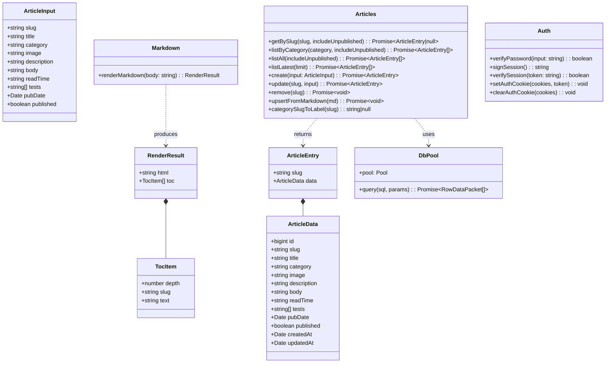
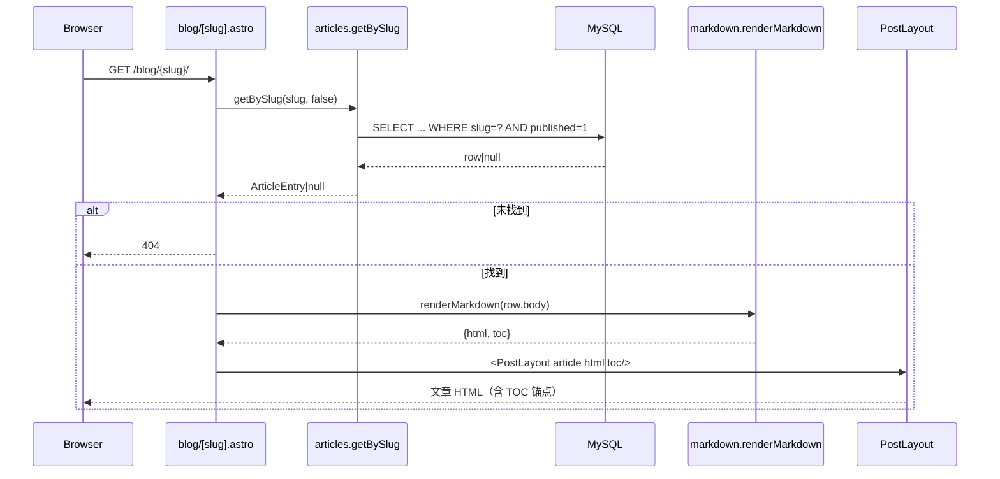
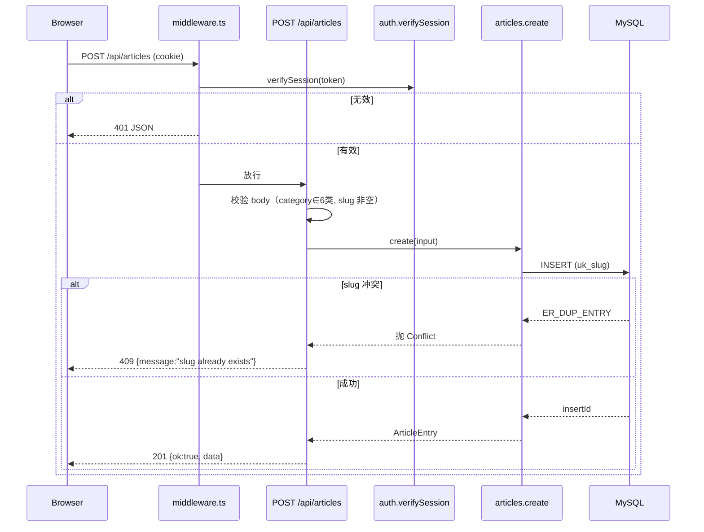
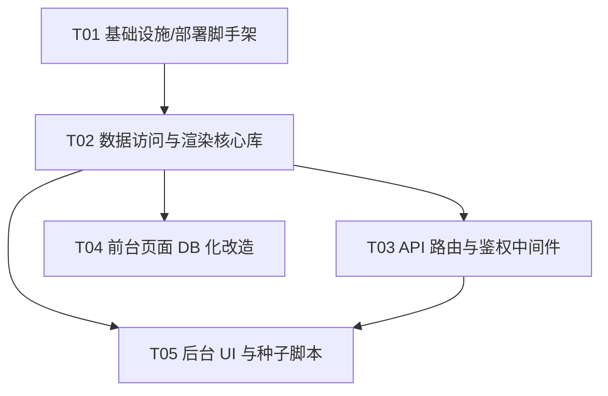

# kavalo.top 全栈升级 — 系统架构设计 + 任务分解（v1）

> 文档角色：架构师（高见远）输出，供工程师按序实现
> 基线：现有 Astro 4.16 静态站（37 页 / 25 篇文章，content collections 驱动）
> 目标：SSR + MySQL 全栈动态站，单管理员密码鉴权，Docker 自托管，前台零回归

---

## 0. 已确认决策基线

| 维度 | 决策 |
|---|---|
| 架构 | Astro 改 SSR，`@astrojs/node` 适配器 `output:'server'`，文章运行时从 MySQL 读 |
| 部署 | VPS + Docker 自托管（docker-compose：Node 服务 + MySQL 8 + 数据卷） |
| 鉴权 | 单管理员密码（环境变量 `ADMIN_PASSWORD`）+ httpOnly cookie（v1 加签名与 24h 过期） |
| 设计原则 | 最小可用（MVP），不引入缓存 / 对象存储 / 多管理员等 P2 能力 |

---

## 1. 技术栈与依赖包清单

### 1.1 保留
- `astro@^4.16`（已存在）
- `@astrojs/rss@^4`（RSS 仍用，保留）

### 1.2 新增依赖
| 包 | 用途 |
|---|---|
| `@astrojs/node` | SSR 适配器（standalone 模式，输出 `dist/server/entry.mjs`） |
| `mysql2` | MySQL 连接池（Promise 接口），读文章 / 后台 CRUD |
| `marked` | 运行时把 Markdown `body` 渲染为 HTML（替代 `post.render()` 的 `Content`） |
| `github-slugger` | 给标题生成 `id`，算法与 `rehype-slug` 一致，保证 TOC 锚点零回归 |
| `gray-matter` | seed 脚本解析 `src/content/blog/*.md` 的 frontmatter |
| `dotenv` | seed / 脚本在 Node 侧加载 `.env`（Astro 运行时自动加载，脚本需显式加载） |

### 1.3 开发依赖
| 包 | 用途 |
|---|---|
| `tsx` | 以 TypeScript 直接跑 `scripts/seed.ts`（无需编译） |

### 1.4 移除
- `@astrojs/sitemap`：SSR 下无法自动发现无 `getStaticPaths` 的 `[slug]` 动态路由，改用自定义 `sitemap.xml.ts`（见 §9 决策 9）。
- `rehype-slug`：仅在 content collections 渲染期生效；改 `marked + github-slugger` 后不再需要。

> 注：`astro.config.mjs` 的 `markdown.rehypePlugins` 也可一并清空。

---

## 2. 目录 / 文件清单（相对工程根 `E:/kavalo.top/kavalo-astro`）

### 2.1 新增
| 路径 | 说明 |
|---|---|
| `src/lib/db.ts` | mysql2 连接池单例，从环境变量读配置 |
| `src/lib/types.ts` | 共享类型：`ArticleInput` / `ArticleData` / `ArticleEntry` / `TocItem` / `RenderResult` |
| `src/lib/articles.ts` | DB 读写：`getBySlug` / `listByCategory` / `listAll` / `listLatest` / `create` / `update` / `remove` / `upsertFromMarkdown`；含 `categorySlugToLabel()` 工具 |
| `src/lib/markdown.ts` | `marked + github-slugger` 渲染为 HTML + 抽取 h2/h3 TOC |
| `src/lib/auth.ts` | 密码校验、`signSession` / `verifySession`（HMAC）、cookie 签发/清除 |
| `src/middleware.ts` | 全局中间件：保护 `/admin/*`（页）与 `/api/articles*`（JSON），校验签名 cookie |
| `src/pages/api/login.ts` | POST 登录，校验密码并下发 cookie |
| `src/pages/api/logout.ts` | POST 退出，清除 cookie |
| `src/pages/api/articles.ts` | GET 列表（分页/筛选/搜索）/ POST 新建（均需鉴权） |
| `src/pages/api/articles/[slug].ts` | GET/PUT/DELETE 单篇（均需鉴权） |
| `src/pages/admin/login.astro` | 登录页（密码输入 + 错误提示） |
| `src/pages/admin/index.astro` | 后台首页 / 入口，登录后常驻顶栏 |
| `src/pages/admin/posts.astro` | 文章列表（搜索 / 分类 / 状态筛选 / 分页） |
| `src/pages/admin/posts/[slug].astro` | 新建 / 编辑表单（标题/分类/封面URL/简介/正文MD/阅读时长/测试标签/发布日期/发布状态） |
| `src/pages/sitemap.xml.ts` | 自定义 sitemap：DB 文章 slug + 静态路由（替代 `@astrojs/sitemap`） |
| `scripts/schema.sql` | 建表 DDL（幂等 `IF NOT EXISTS`） |
| `scripts/seed.ts` | 解析 `src/content/blog/*.md` 注入 MySQL（幂等 upsert） |
| `Dockerfile` | 多阶段/单阶段构建 node standalone |
| `docker-compose.yml` | `app`（node）+ `db`（mysql:8，卷 + initdb 挂 schema） |
| `.dockerignore` | 排除 node_modules / dist / .env 等 |
| `.env.example` | 所有环境变量模板 |
| `deploy.sh` | 一键：build → compose up → 等待 DB → seed |
| `Makefile`（可选） | 包装 `make build / up / seed / deploy` |

### 2.2 修改
| 路径 | 改动要点 |
|---|---|
| `astro.config.mjs` | 加 `output:'server'`、`adapter: node({mode:'standalone'})`、移除 `sitemap()`、设 `server.port/host` |
| `package.json` | 加依赖与脚本（`seed` / `migrate` / `deploy`）；移除 `@astrojs/sitemap`、`rehype-slug` |
| `src/pages/blog/[slug].astro` | 移除 `getStaticPaths` 与 `getCollection`；改为按 `Astro.params.slug` 从 DB 读，404 处理 |
| `src/pages/blog/index.astro` | `getCollection` → `articles.listAll()` |
| `src/pages/blog/category/[category].astro` | 移除 `getStaticPaths`；按 URL slug 映射 label 查 `listByCategory` |
| `src/pages/corgi/gear.astro` | `getCollection` → `articles.listAll()`，JS 内按 category 分组 |
| `src/pages/rss.xml.ts` | `getCollection` → `articles.listAll()`（保留字段映射） |
| `src/layouts/PostLayout.astro` | 不再 `post.render()`；改为接收 `article: ArticleEntry` + `html` + `toc` 三个 props |
| `src/components/PostCard.astro` | `post` 类型由 `CollectionEntry<'blog'>` 改为 `ArticleEntry`（结构兼容，基本只改类型注解） |

> 设计要点：`articles.ts` 返回的 `ArticleEntry` 刻意保持 `{ slug, data: {...} }` 形状，与 `CollectionEntry<'blog'>` 一致，从而 `PostCard` / `PostLayout` / `CategoryList` 仅需小幅改动（类型注解 + 用 `html/toc` 代替 `post.render()`），最大化前台零回归。

---

## 3. 数据库表结构（DDL）

```sql
-- scripts/schema.sql  (幂等，可重复执行)
CREATE DATABASE IF NOT EXISTS kavalo
  CHARACTER SET utf8mb4
  COLLATE utf8mb4_unicode_ci;

USE kavalo;

CREATE TABLE IF NOT EXISTS articles (
  id          BIGINT UNSIGNED NOT NULL AUTO_INCREMENT,
  slug        VARCHAR(255) NOT NULL,
  title       VARCHAR(255) NOT NULL,
  category    VARCHAR(64)  NOT NULL,
  image       VARCHAR(512) DEFAULT NULL,
  description TEXT,
  body        LONGTEXT     NOT NULL,
  read_time   VARCHAR(32)  DEFAULT NULL,
  tests       JSON         DEFAULT NULL,
  pub_date    DATETIME     NOT NULL,
  published   TINYINT(1)   NOT NULL DEFAULT 1,
  created_at  DATETIME     NOT NULL DEFAULT CURRENT_TIMESTAMP,
  updated_at  DATETIME     NOT NULL DEFAULT CURRENT_TIMESTAMP ON UPDATE CURRENT_TIMESTAMP,
  PRIMARY KEY (id),
  UNIQUE KEY uk_slug (slug),
  KEY idx_category (category),
  KEY idx_pub_date (pub_date)
) ENGINE=InnoDB DEFAULT CHARSET=utf8mb4 COLLATE=utf8mb4_unicode_ci;
```

字段说明：
- `slug` 唯一索引，URL 标识；冲突策略见 §9 决策 2。
- `category` 存 **label 字符串**（与现有 frontmatter 一致，如 `"backpack carrier"`）。
- `tests` 用 JSON 列存标签数组；mysql2 读取为字符串，由 `articles.ts` 解析为 `string[]`。
- `pub_date` 存 UTC `DATETIME`；渲染时 `toLocaleDateString('en-US', …)` 与现有显示一致。
- `published`：`TINYINT(1)` 默认 1（决策 3），v1 预留草稿能力。

---

## 4. 核心库设计（数据结构与接口）



### 4.1 `src/lib/db.ts`
- 模块级单例：`mysql.createPool({ host, port, user, password, database, waitForConnections, connectionLimit: 10 })`，读 `process.env.DB_*`。
- 导出 `pool` 与 `query()` 封装；避免 SSR 热重载重复建池（挂到 `globalThis`）。

### 4.2 `src/lib/types.ts`
- `ArticleInput`：后台表单 / API 输入。
- `ArticleData`：DB 行映射（含 `id/createdAt/updatedAt`）。
- `ArticleEntry`：`{ slug: string; data: ArticleData }` —— 与 `CollectionEntry<'blog'>` 兼容。
- `TocItem`：`{ depth: 2|3; slug: string; text: string }`。
- `RenderResult`：`{ html: string; toc: TocItem[] }`。

### 4.3 `src/lib/articles.ts`
- `getBySlug(slug, includeUnpublished=false)`：前台只查 `published=1`；后台传 `true`。
- `listByCategory(label, includeUnpublished=false)`：`WHERE category=? AND (published=1) ORDER BY pub_date DESC`。
- `listAll(includeUnpublished=false)`：全量倒序（前台/列表/hub/RSS）。
- `listLatest(limit)`：最新 N 篇（RSS 用）。
- `create(input)`：`INSERT`；捕获 `ER_DUP_ENTRY` 转为“slug 已存在”冲突错误。
- `update(slug, input)`：按 slug 更新；若改 slug 冲突则报 409。
- `remove(slug)`：`DELETE WHERE slug=?`。
- `upsertFromMarkdown(md)`：`INSERT ... ON DUPLICATE KEY UPDATE`（按 slug 幂等），供 seed 调用。
- `categorySlugToLabel(slug)`：从 `site.ts` 的 `CATEGORIES` 映射（URL slug → label），供分类页 / 校验用。
- 行 → `ArticleEntry` 映射：把 `tests` JSON 字符串 `JSON.parse` 为数组；日期保持 `Date`。

### 4.4 `src/lib/markdown.ts`
- `renderMarkdown(body: string): RenderResult`
  - 用 `marked` 解析；自定义 heading renderer 调用 `GithubSlugger` 给每个 `h2/h3` 注入 `id`（算法等同 `rehype-slug`，保证锚点一致）。
  - 同时遍历生成 `toc`：`depth ∈ {2,3}`，`slug` 与标题 `id` 同源，`text` 为纯文本。
  - 返回 `{ html, toc }`，注入文章页。
- 安全：v1 内容由单可信管理员在后台撰写，风险低；`marked` 默认不开启原始 HTML 透传即可。XSS 深度防护列为 P2。

### 4.5 `src/lib/auth.ts`
- `verifyPassword(input)`：`crypto.timingSafeEqual` 比对 `input` 与 `process.env.ADMIN_PASSWORD`（均做 SHA-256 后比，避免长度不等异常）。
- `signSession()`：payload `{ iat, exp=iat+24h }` → `base64url(payload) + '.' + HMAC-SHA256(payload, SESSION_SECRET)`。
- `verifySession(token)`：重算 HMAC 比对 + 校验 `exp`。
- `setAuthCookie(cookies, token)` / `clearAuthCookie(cookies)`：经 `Astro.cookies.set('auth_token', …, { httpOnly:true, secure:true, sameSite:'lax', path:'/', maxAge:86400 })`。

---

## 5. API 路由设计

统一响应包：`{ ok: boolean, message?: string, data?: any }`。
统一错误码：400（参数）/ 401（未登录）/ 403（禁止）/ 404（不存在）/ 409（冲突）/ 500。

| 方法 & 路径 | 鉴权 | 请求 | 响应 |
|---|---|---|---|
| `POST /api/login` | 否 | `{ password }` | 200 `{ok:true}` + `Set-Cookie auth_token`；401 `{ok:false,message:"Invalid credentials"}` |
| `POST /api/logout` | 否 | — | 200 `{ok:true}` + 清除 cookie |
| `GET /api/articles` | 是 | `?category=&q=&status=published\|draft\|all&page=1&pageSize=20` | 200 `{ok:true,data:{items:ArticleEntry[],total}}` |
| `POST /api/articles` | 是 | `ArticleInput` | 201 `{ok:true,data}`；400（category 不在 6 类 / slug 空）；409（slug 已存在） |
| `GET /api/articles/[slug]` | 是 | — | 200 `{ok:true,data}`；404 |
| `PUT /api/articles/[slug]` | 是 | 部分 `ArticleInput` | 200 `{ok:true,data}`；409（slug 冲突）；404 |
| `DELETE /api/articles/[slug]` | 是 | — | 200 `{ok:true}` |

> `category` 校验：必须 ∈ `site.ts` 的 6 个 `label`；否则 400。

---

## 6. 后台鉴权流程

```
[浏览器] --POST /api/login {password}--> [api/login.ts]
        --> auth.verifyPassword(input) 比对 ADMIN_PASSWORD
        成功 --> auth.signSession() 生成签名 token
                --> Astro.cookies.set('auth_token', token, {httpOnly,secure,sameSite:lax,maxAge:86400})
                <-- 200 {ok:true} + Set-Cookie

[浏览器] --携带 cookie 访问 /admin/posts--> [middleware.ts]
        --> auth.verifySession(token)
            失败 --> 页面请求 302 跳 /admin/login；/api/* 返回 401 JSON
            成功 --> Astro.locals.auth = true，放行

[浏览器] --POST /api/logout--> [api/logout.ts] --> clearAuthCookie() <-- 200 {ok:true}
```

- 中间件保护范围：`/admin/*`（除 `/admin/login`）+ `/api/articles*`。
- 页面守卫失败 → 重定向登录页；API 守卫失败 → 401 JSON（便于前端提示）。
- token 含 24h 过期，过期即视为未登录。

---

## 7. 程序调用流程

### 7.1 前台文章请求链路


### 7.2 后台 CRUD（新建）链路


> 列表 / 编辑 / 删除链路同构，仅路由与方法不同；均经中间件鉴权。

---

## 8. 前台页面改造要点（零回归）

| 页面 | 改造 |
|---|---|
| `blog/[slug].astro` | 去 `getStaticPaths`；`Astro.params.slug` → `getBySlug`；空则 404；`renderMarkdown` 得 `html/toc` 传给 `PostLayout`；相关文章逻辑用 `listAll` 在 JS 内复算（取同 category 3 篇，不足补其他） |
| `blog/index.astro` | `listAll()` 倒序 → `PostCard`（结构兼容） |
| `blog/category/[category].astro` | 去 `getStaticPaths`；URL slug → `categorySlugToLabel` → `listByCategory(label)`；未知分类 404 |
| `corgi/gear.astro` | `listAll()` 后在 JS 内按 `category` 分组，复刻现有 section 渲染 |
| `rss.xml.ts` | `listAll()` → `rss()`，保留 `title/pubDate/description/link:/blog/{slug}/` |
| `sitemap.xml.ts`（新） | 静态路由（首页/blog/各分类 how-we-test/about）+ `listAll()` 每篇 `/blog/{slug}/`，拼 XML 返回 `Content-Type: application/xml` |
| `PostLayout.astro` | props 改为 `article: ArticleEntry` + `html` + `toc`；`<Content />` 改为 `set:html={html}`；TOC 用 `toc` 渲染 |
| `PostCard.astro` | 类型注解 `CollectionEntry<'blog'>` → `ArticleEntry`（`slug`/`data.*` 字段一致，几乎零改） |

> 保留 `src/styles/global.css` 与现有组件样式，后台复用前台设计语言，不引入新 UI 库。

---

## 9. PRD「9 个待确认项」— v1 默认决策

| # | 待确认 | v1 决策 | 理由（最小可用） |
|---|---|---|---|
| 1 | 运行期直连是否加缓存 | **不加缓存**（连接池复用即可） | 25 篇 + 单管理员，MySQL 直连延迟可忽略；缓存引入失效复杂度，违背最小可用。P2 再加 |
| 2 | slug 冲突策略 | **UNIQUE 约束 + 后台提交重复返回 409 + 明确提示** | 不自动加后缀，保持 URL 稳定可预测；冲突时前端提示“slug 已存在，请修改” |
| 3 | 草稿/发布 status 字段 | **加 `published` TINYINT(1) DEFAULT 1** | v1 后台默认发布；预留草稿能力（列表显示状态），不在 v1 做复杂草稿流 |
| 4 | 存量 25 篇播种方式 | **seed 脚本解析 `src/content/blog/*.md` 注入 MySQL** | 用 `gray-matter` 读 frontmatter，作者/正文一一对应；`ON DUPLICATE KEY UPDATE` 幂等；部署流程在 DB 起服后执行一次 |
| 5 | Markdown 运行期渲染 | **`marked` + `github-slugger`** 生成 heading `id`（对齐 `rehype-slug`），输出 HTML 注入；TOC 同源抽取 h2/h3 | 直接替代 `post.render()` 的 `Content`/`headings`，锚点零回归 |
| 6 | 封面图存储 | **v1 沿用 `public/images` 静态资源，`image` 存 URL 字符串** | 后台填 URL，不上传落盘；图片上传/对象存储列为 P1 |
| 7 | category 是否限定 6 类 | **是**，后台下拉来自 `site.ts` 的 `CATEGORIES`，API 层校验 ∈ 6 类 | 防脏数据；DB 存 label 字符串（与现有 frontmatter 一致） |
| 8 | cookie 是否签名/过期 | **加 `SESSION_SECRET` 环境变量；cookie 存 HMAC-SHA256 签名 token + 24h 过期** | 防篡改；`httpOnly + secure + sameSite=lax`；用 Node 内置 `crypto`，零额外依赖 |
| 9 | `@astrojs/sitemap` SSR 行为 | **v1 移除集成，改用自定义 `src/pages/sitemap.xml.ts`** | SSR 下 `@astrojs/sitemap` 无法自动发现无 `getStaticPaths` 的 `[slug]` 动态路由；自定义端点从 DB 读 slug + 静态路由，保证动态文章全收录、零 SEO 回归 |

---

## 10. 共享约定

- **环境变量命名**：`DB_HOST` / `DB_PORT` / `DB_USER` / `DB_NAME` / `DB_PASSWORD` / `ADMIN_PASSWORD` / `SESSION_SECRET` / `SITE_URL` / `NODE_ENV` / `PORT`。
- **DB 连接单例**：`src/lib/db.ts` 模块级 `pool` 并挂 `globalThis`，避免 SSR 热重载重复建连。
- **错误处理**：API 统一返回 `{ok, message, data?}`；页面/后台用 `try/catch` 展示 `message`，不抛原始堆栈。
- **时间**：`pub_date` 存 UTC；展示统一 `toLocaleDateString('en-US', {year,month,day})`，与现有一致。
- **类型复用**：所有页面/组件统一消费 `ArticleEntry`（`{slug, data}`），降低改造面。
- **分类映射**：URL 用 `slug`，DB 用 `label`，统一经 `categorySlugToLabel()` 互转。
- **种子幂等**：`schema.sql` 用 `IF NOT EXISTS`；seed 用 `ON DUPLICATE KEY UPDATE`，可重复跑不重复数据。

---

## 11. 有序任务列表（按实现顺序，含依赖与验收点）

> 任务上限 5 个（按模块/层次分组，首任务为基础设施，每个任务 ≥3 文件）。

### T01 — 项目基础设施与部署脚手架
- **涉及文件**：`package.json`、`astro.config.mjs`、`.env.example`、`.dockerignore`、`.gitignore`、`Dockerfile`、`docker-compose.yml`、`scripts/schema.sql`
- **依赖**：无（首项）
- **优先级**：P0
- **验收点**：
  - `npm install` 可装齐 `@astrojs/node`/`mysql2`/`marked`/`github-slugger`/`gray-matter`/`dotenv`/`tsx`；`npm run build` 产出 `dist/server/entry.mjs`（standalone）。
  - `docker-compose.yml` 起 `db` + `app`；`db` 首次启动经 `docker-entrypoint-initdb.d` 执行 `schema.sql` 建表，可重复 `up` 不报错。
  - `.env.example` 覆盖全部必需变量；`.gitignore` 含 `node_modules/`、`dist/`、`.env`。

### T02 — 数据访问与渲染核心库
- **涉及文件**：`src/lib/db.ts`、`src/lib/types.ts`、`src/lib/articles.ts`、`src/lib/markdown.ts`、`src/lib/auth.ts`
- **依赖**：T01（schema 与依赖就绪）
- **优先级**：P0
- **验收点**：
  - `db.ts` 导出可用 `pool`；`articles.ts` 的 8 个方法签名齐备且能连库读写。
  - `markdown.renderMarkdown` 输出 HTML 且 h2/h3 带 `id`（与 `github-slugger` 一致），`toc` 含 depth 2–3。
  - `auth.ts` 能校验密码、签发/校验 24h 签名 token、设置/清除 httpOnly cookie。

### T03 — API 路由与鉴权中间件
- **涉及文件**：`src/middleware.ts`、`src/pages/api/login.ts`、`src/pages/api/logout.ts`、`src/pages/api/articles.ts`、`src/pages/api/articles/[slug].ts`
- **依赖**：T02
- **优先级**：P0
- **验收点**：
  - 未登录访问 `/api/articles*` 返回 401；`/admin/*` 页面被重定向到登录页。
  - 正确密码登录后下发 `auth_token` cookie；错误密码返回 401 且不泄露信息。
  - POST 新建重复 slug 返回 409；`category` 非法返回 400；PUT/DELETE 生效。
  - 退出登录清除 cookie。

### T04 — 前台页面 DB 化改造
- **涉及文件**：`src/pages/blog/[slug].astro`、`src/pages/blog/index.astro`、`src/pages/blog/category/[category].astro`、`src/pages/corgi/gear.astro`、`src/pages/rss.xml.ts`、`src/pages/sitemap.xml.ts`、`src/layouts/PostLayout.astro`、`src/components/PostCard.astro`
- **依赖**：T02
- **优先级**：P0
- **验收点**：
  - 25 篇文章均可从 DB 读取并正确渲染，TOC 锚点与旧站一致；未知 slug / 未知分类返回 404。
  - `blog/index`、`corgi/gear`、分类页、RSS 在视觉/路由/字段上与旧站零回归。
  - `sitemap.xml` 含全部动态文章 URL + 静态路由。
  - 保留 `global.css` 与现有组件样式。

### T05 — 后台 UI 与种子脚本
- **涉及文件**：`src/pages/admin/login.astro`、`src/pages/admin/index.astro`、`src/pages/admin/posts.astro`、`src/pages/admin/posts/[slug].astro`、`scripts/seed.ts`、`deploy.sh`、`Makefile`
- **依赖**：T02、T03
- **优先级**：P0
- **验收点**：
  - 管理员可在后台完成文章增 / 改 / 删 / 列表（搜索、分类、状态筛选）；未登录无法访问。
  - `scripts/seed.ts` 解析 25 篇 `.md` 注入 MySQL，字段一一对应，幂等可重跑。
  - `deploy.sh` 在空白环境一条命令完成 build → 起服 → 建表 → 播种；配置仅经 `.env`。
  - `git init` 后敏感信息不进仓库。

---

## 12. 任务依赖图



---

## 13. 待澄清 / 风险（Anything UNCLEAR）

1. **content collections 去留**：PRD 要求移除其作为数据源，但 `src/content/blog/*.md` 仍要保留给 seed 读取。建议：删除 `src/content/config.ts` 与页面里的 `getCollection` 导入；seed 用 `gray-matter` 直接读 `.md`（不走 `astro:content`）。需验证 Astro 在 `output:'server'` 下无 `content/config.ts` 时不再报错（content 目录仅作静态文件看待）。若 Astro 仍要求 config，可把 `.md` 移到 `scripts/seed-content/` 由 seed 读取——本设计默认保留原位 + 删 config。
2. **TLS / 反代**：v1 仅暴露 node（默认 4321），生产 HTTPS 建议前置 Caddy/Traefik。列为运维备注，不在 v1 任务内。
3. **Markdown XSS**：v1 内容来自单可信管理员，`marked` 默认不透传原始 HTML；深度净化（如 DOMPurify）列为 P2。
4. **`tests` JSON 解析**：mysql2 默认返回 JSON 列为字符串，需在 `articles.ts` 统一 `JSON.parse`；空值兜底为 `[]`。
5. **`pub_date` 时区**：seed 把 frontmatter `pubDate`（如 `"2026-08-12"`）解析为 `YYYY-MM-DD 00:00:00` UTC；前台展示用 `toLocaleDateString` 与旧站一致即可，无需本地时区存储。
6. **standalone 端口**：`@astrojs/node` standalone 监听端口由 `astro.config` 的 `server.port` 决定；设计中读 `process.env.PORT`（默认 4321），docker 内映射该端口。
